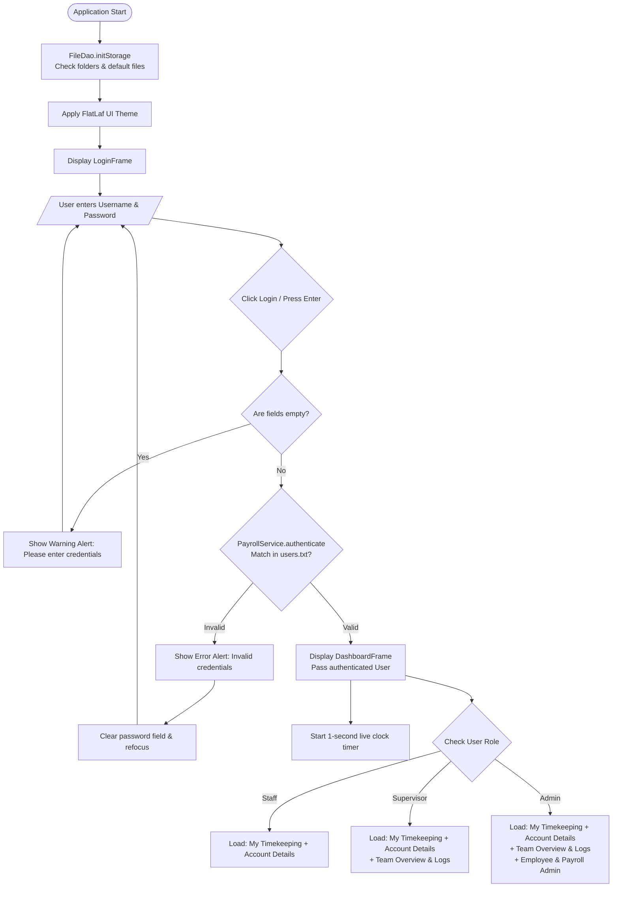
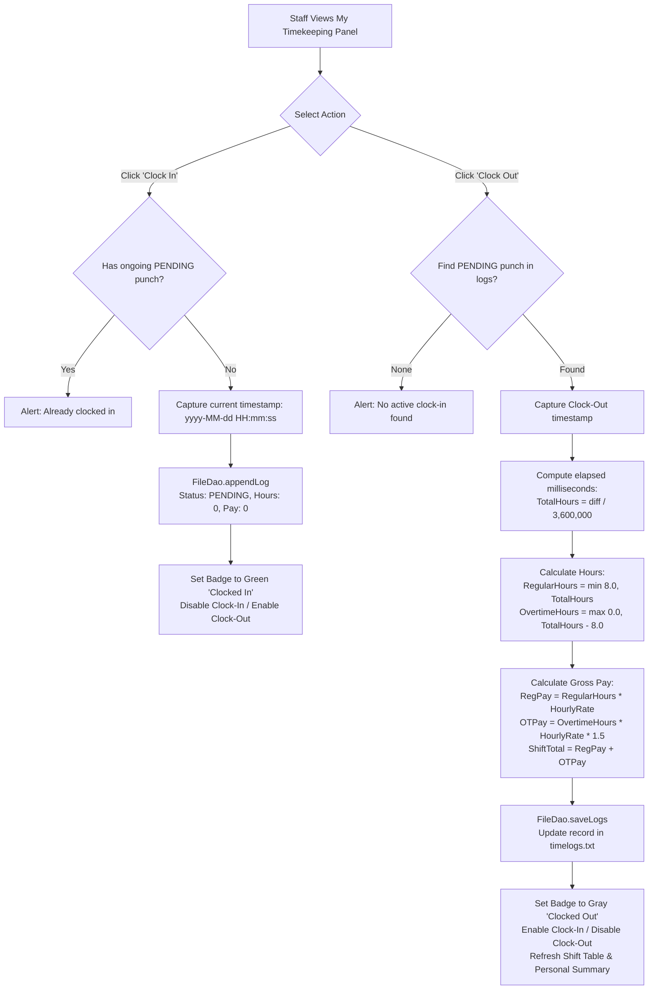
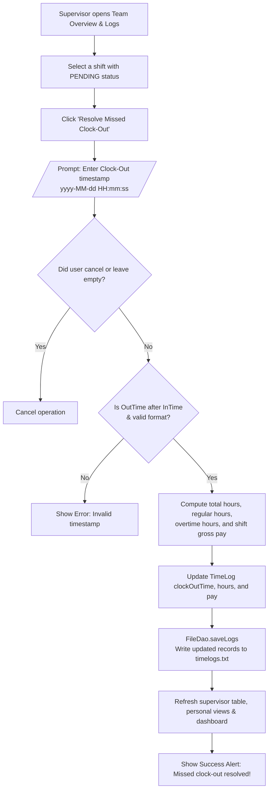
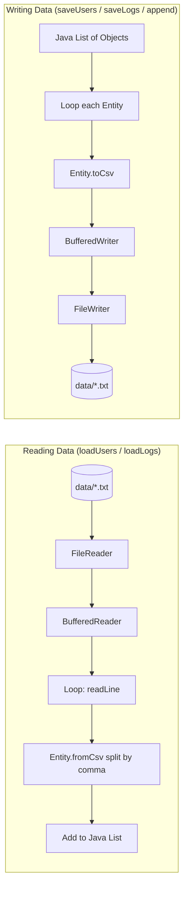

# Staff Timekeeping and Payroll Desktop Application
# SYSTEM FLOWCHARTS & PROCESS LOGIC

This document provides visual flowcharts and logic diagrams for the **Staff Timekeeping & Payroll System** as required by the **DLSU-D S-ITCS112 Fundamentals of Programming** rubric.

> **Tip:** You can paste any of the Mermaid diagrams below into [Mermaid Live Editor](https://mermaid.live) to download high-resolution PNG or SVG images for your final document or slides.

---

## 1. Overall System Architecture & Authentication Flow



---

## 2. Shift Lifecycle & Timekeeping Logic (Clock In / Clock Out)



---

## 3. Payroll Calculation & Official Pay Slip Generation

```mermaid
flowchart TD
    TriggerSlip[User clicks 'Generate Pay Stub'] --> LoadLogs[Load all timelogs for Employee]
    LoadLogs --> FilterCompleted{Any completed non-pending shifts?}
    
    FilterCompleted -- No --> ShowNoData[Alert: No completed shifts found]
    FilterCompleted -- Yes --> Accumulate[Sum totals across completed shifts:\nTotalRegHours = sum RegularHours\nTotalOTHours = sum OvertimeHours\nGrossPay = sum ShiftTotalPay]
    
    Accumulate --> CalcDeductions[Calculate Statutory Deductions:\nTax = GrossPay * 0.10 (10% Withholding)\nBenefits = GrossPay * 0.04 (4% SSS/Health)\nTotalDeductions = Tax + Benefits]
    
    CalcDeductions --> CalcNet[Calculate Take-Home Pay:\nNetPay = GrossPay - TotalDeductions]
    
    CalcNet --> BuildText[Format Official Text Pay Slip\nInclude Header, Itemized Shift Rows,\nEarnings Breakdown, Deductions, and Net Pay]
    
    BuildText --> SaveTxt[Save text backup to paystubs/PayStub_EMP_TIMESTAMP.txt]
    SaveTxt --> ShowDialog[Display PayStubDialog Modal Preview]
    
    ShowDialog --> PDFAction{Click 'Create PDF & Open in Browser'?}
    PDFAction -- Yes --> OpenPDFLib[Use OpenPDF PdfWriter\nRender monospace text to PDF document]
    OpenPDFLib --> SavePDFFile[Save to paystubs/PayStub_EMP_TIMESTAMP.pdf]
    SavePDFFile --> LaunchBrowser[Desktop.getDesktop.browse\nOpen generated PDF in system web browser]
    PDFAction -- No --> CloseDialog[Close Preview]
```

---

## 4. Supervisor Shift Resolution Logic



---

## 5. File Persistence Mechanics (Read / Write Flow)


