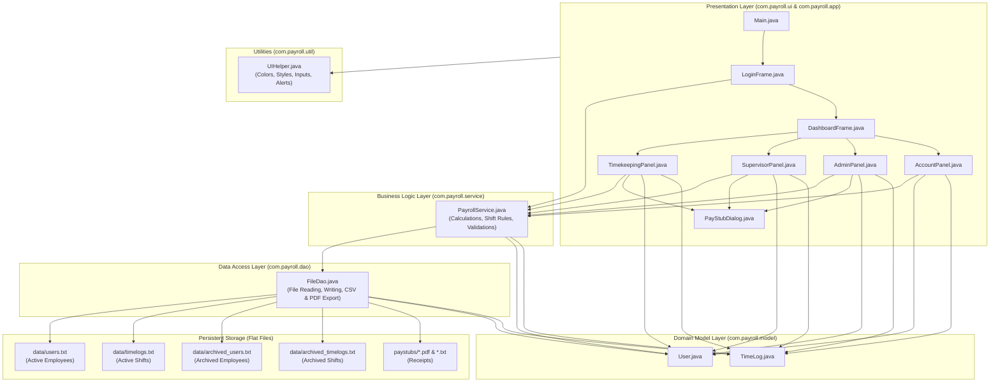
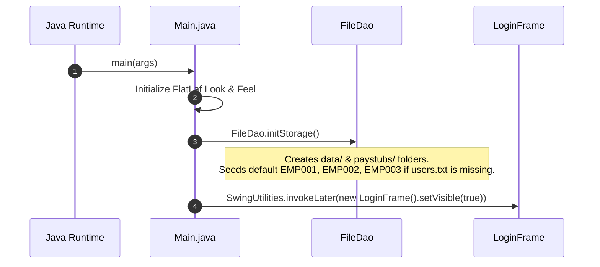
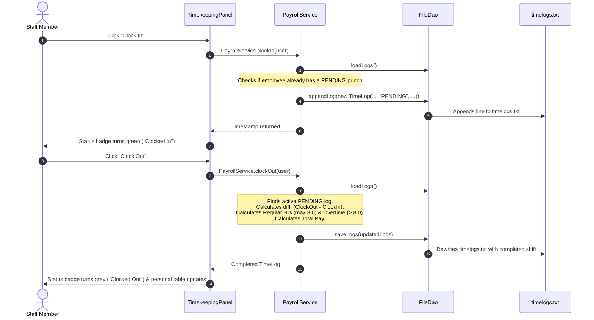

# Staff Timekeeping & Payroll System: Complete Code & Architecture Study Guide

This guide breaks down every class, design pattern, mathematical formula, and data flow in the **Staff Timekeeping & Payroll System**. It is designed to help you understand how the system works end-to-end, study for exams/defenses, and learn how to replicate or extend it.

---

## 1. High-Level Architecture Overview

The system is organized into a clean **Layered Architecture (Separation of Concerns)**:



### Architectural Responsibilities:
1. **Model (`User`, `TimeLog`)**: Pure data-holding objects (POJOs) with CSV parsing and serialization methods.
2. **DAO (`FileDao`)**: Deals only with filesystem reads/writes (`BufferedReader`, `BufferedWriter`, PDF generation). Does not contain payroll math.
3. **Service (`PayrollService`)**: The "brain". Contains hours math, overtime computation, tax/benefit deductions, authentication checks, and business rules.
4. **UI (`LoginFrame`, `DashboardFrame`, etc.)**: Presentation views that capture user clicks, validate inputs using `UIHelper`, and call `PayrollService`.
5. **Util (`UIHelper`)**: Factory methods for consistent fonts, FlatLaf palette colors, borders, and modal dialogs.

---

## 2. System Execution Flow

### A. Application Startup


### B. Shift Clock-In & Clock-Out Cycle


---

## 3. Class-by-Class Deep Dive

### Package: `com.payroll.app`

#### `Main.java`
- **Purpose**: Program entry point.
- **Key Methods**:
  - `main(String[] args)`:
    1. Sets modern FlatLaf theme (`UIManager.setLookAndFeel("com.formdev.flatlaf.FlatLightLaf")`) with graceful native OS fallback.
    2. Calls `FileDao.initStorage()` to ensure folders and initial admin credentials exist.
    3. Launches `LoginFrame` on Swing's **Event Dispatch Thread (EDT)** via `SwingUtilities.invokeLater(...)`.

---

### Package: `com.payroll.model`

#### `User.java`
- **Purpose**: Represents an employee identity, credentials, permissions, and compensation rate.
- **Fields**:
  - `employeeId` (e.g., `EMP001`)
  - `name` (e.g., `"Admin User"`)
  - `username` (e.g., `"admin"`)
  - `password` (e.g., `"admin123"`)
  - `role` (`"Admin"`, `"Supervisor"`, or `"Staff"`)
  - `hourlyRate` (e.g., `500.00`)
- **Key Methods**:
  - `toCsv()`: Returns `EMP001,Admin User,admin,admin123,Admin,500.00`.
  - `fromCsv(String line)`: Splits line by comma, converts parts into types, handles legacy decimal notation (such as dot or comma splits), returns new `User` object.
  - `isAdmin()`, `isSupervisor()`, `hasSupervisorAccess()`: Role checks controlling tab access.

#### `TimeLog.java`
- **Purpose**: Represents an employee's single work shift and its earnings.
- **Fields**:
  - `employeeId`, `name`, `date` (`yyyy-MM-dd`)
  - `clockInTime` (`yyyy-MM-dd HH:mm:ss`)
  - `clockOutTime` (`yyyy-MM-dd HH:mm:ss` or `"PENDING"`)
  - `regularHours`, `overtimeHours`, `totalPay`
- **Key Methods**:
  - `isPending()`: Checks if `clockOutTime` is `"PENDING"` or null. When true, the shift is ongoing.
  - `toCsv()`: Serializes all 8 fields to a comma-separated string.
  - `fromCsv(String line)`: Parses 8 comma-separated fields into a `TimeLog` instance.

---

### Package: `com.payroll.dao`

#### `FileDao.java`
- **Purpose**: The Data Access Object responsible for all file reads and writes.
- **Key Paths**:
  - `data/users.txt`: Active user records.
  - `data/timelogs.txt`: Active shift punches.
  - `data/archived_users.txt`: Deactivated/archived users.
  - `data/archived_timelogs.txt`: Deactivated/archived shift records.
  - `paystubs/`: Output directory for generated text files and PDFs.
- **Key Methods**:
  - `initStorage()`: Creates folders (`mkdirs()`) and generates default starter accounts if missing.
  - `loadUsers()` / `loadLogs()`: Uses `BufferedReader` and `FileReader` inside a `try-with-resources` block to read lines sequentially.
  - `saveUsers(List<User>)` / `saveLogs(List<TimeLog>)`: Uses `BufferedWriter` and `FileWriter(path, false)` to overwrite the entire file with fresh lists.
  - `appendUser(User)` / `appendLog(TimeLog)`: Uses `new FileWriter(path, true)` to append a single line quickly without rewriting the whole file.
  - `archiveUser(String id)` / `restoreUser(String id)`: Moves a record between `users.txt` and `archived_users.txt`.
  - `savePayStubPdf(String empId, String text)`: Uses the OpenPDF library (`com.lowagie.text.Document`, `PdfWriter`) to format the plain text into an official PDF document.

---

### Package: `com.payroll.service`

#### `PayrollService.java`
- **Purpose**: Core business engine and mathematical formulas.
- **Constants**:
  - `STANDARD_HOURS = 8.0`
  - `OT_MULTIPLIER = 1.5` (Overtime rate = $150\%$ of base rate)
  - `TAX_RATE = 0.10` (10% Withholding tax)
  - `BENEFIT_RATE = 0.04` (4% Social Security / Health / Pag-IBIG)
- **Calculation Methods**:
  - `calcTotalHours(inStr, outStr)`: Parses timestamps using `SimpleDateFormat`, calculates millisecond difference, and converts to fractional hours:
    $$\text{Hours} = \frac{\text{out.getTime}() - \text{in.getTime}()}{1000 \times 60 \times 60}$$
  - `calcRegularHours(total)`: Returns $\min(8.0, \text{total})$.
  - `calcOvertimeHours(total)`: Returns $\max(0.0, \text{total} - 8.0)$.
  - `calcGrossPay(regH, otH, rate)`:
    $$\text{Gross} = (\text{regH} \times \text{rate}) + (\text{otH} \times \text{rate} \times 1.5)$$
  - `calcTax(gross)`: $\text{Gross} \times 0.10$
  - `calcBenefits(gross)`: $\text{Gross} \times 0.04$
  - `calcNetPay(gross)`: $\text{Gross} - (\text{Tax} + \text{Benefits})$
- **Workflow Operations**:
  - `authenticate(username, password)`: Searches `loadUsers()` for username/password match.
  - `clockIn(User)`: Checks for existing pending shifts; if none, appends a new `PENDING` record.
  - `clockOut(User)`: Finds the pending record, computes duration and pay, updates it, and saves.
  - `resolvePendingShift(...)`: Supervisor utility to manually set an exit timestamp for forgotten punches.
  - `generatePayStub(User)`: Aggregates all completed shifts for an employee, formats a text pay slip, saves it to `paystubs/`, and returns the content and file path.

---

### Package: `com.payroll.util`

#### `UIHelper.java`
- **Purpose**: UI design system and Swing boilerplate reducer.
- **Key Features**:
  - **Color Palette**: `HEADER_DARK` (`#1E293B`), `PRIMARY` (`#2563EB`), `SUCCESS` (`#16A34A`), `DANGER` (`#DC2626`), `WARNING` (`#D97706`).
  - **Typography**: Standardized Segoe UI fonts (`FONT_TITLE`, `FONT_HEADER`, `FONT_BOLD`, `FONT_MONO`).
  - `createButton(text, bg, fg, listener)`: Creates flat buttons with hover hand cursors and clean padding.
  - `createPasswordPanel(...)`: Creates a `JPasswordField` with an eye toggle button (`◉`) to reveal/hide passwords.
  - `styleTable(JTable)`: Sets standard row heights, clean borders, header colors, and centered cell renderers.
  - `isValidCsv(String s)`: Validation safeguard to prevent users from injecting commas or newline characters into text fields (which would corrupt the CSV files).

---

### Package: `com.payroll.ui`

#### `LoginFrame.java`
- Displays the login box with username and password inputs.
- Listens for <kbd>Enter</kbd> key presses on both inputs.
- Calls `PayrollService.authenticate(username, password)`.
- If valid, opens `DashboardFrame(user)` and closes itself via `dispose()`.

#### `DashboardFrame.java`
- The parent container for logged-in sessions.
- **Header**: Shows current employee name, ID, role, base rate, live ticking clock (`javax.swing.Timer` firing every second), and status badge (green "Clocked In" vs gray "Clocked Out").
- **Tabs (Role-Based Visibility)**:
  - All users get: **"My Timekeeping"** (`TimekeepingPanel`) and **"Account Details"** (`AccountPanel`).
  - Supervisors & Admins get: **"Team Overview & Logs"** (`SupervisorPanel`).
  - Admins only get: **"Employee & Payroll Admin"** (`AdminPanel`).
- `refreshAll()`: Cascades data updates across all active child panels whenever changes occur.

#### `TimekeepingPanel.java`
- **Employee shift dashboard**:
  - **Clock In button**: Disabled if already clocked in.
  - **Clock Out button**: Disabled if clocked out.
  - **Generate My Pay Stub button**: Generates pay slip for current user and opens `PayStubDialog`.
  - **JTable**: Displays all shift records for this specific employee.

#### `SupervisorPanel.java`
- **Team management screen**:
  - Displays all shift logs from every employee.
  - **Resolve Missed Clock-Out**: If an employee forgot to clock out, the supervisor selects the pending shift, enters the correct exit time, and recalculates pay.
  - **Add Manual Shift Entry**: Enter retroactive shifts.
  - **Archive / Restore / Delete Shifts**: Supervisors can toggle between active and archived views to audit logs.

#### `AdminPanel.java`
- **Administrative control center**:
  - Displays all registered employee accounts in a `JTable`.
  - **+ Add Employee**: Auto-generates the next sequential ID (e.g., `EMP004`), validates inputs, and appends to `users.txt`.
  - **Adjust Rate**: Changes the hourly wage for any worker.
  - **Edit Credentials / Reset Password**: Updates user records in place.
  - **Generate Pay Stub**: Admins can generate a pay slip for any selected employee.
  - **Archive / Restore / Delete**: Deactivates accounts without losing past shift history.

#### `AccountPanel.java`
- Personal profile page allowing any logged-in user to check their own hourly rate and change their login password.

#### `PayStubDialog.java`
- Modal dialog previewing the generated pay slip in fixed-width monospace font (`Consolas`).
- **Create PDF & Open in Browser button**:
  - Calls `FileDao.savePayStubPdf(employeeId, payStubText)`.
  - Uses `Desktop.getDesktop().browse(file.toURI())` to launch the generated PDF in the user's default browser or PDF reader.

---

## 4. Key Mathematical Formulas & Business Rules

| Concept | Rule / Formula | Code Location |
| :--- | :--- | :--- |
| **Shift Duration** | $\text{Hours} = \frac{\text{ClockOut ms} - \text{ClockIn ms}}{3,600,000}$ | `PayrollService.calcTotalHours()` |
| **Regular Hours** | $\min(8.0, \text{Total Hours})$ | `PayrollService.calcRegularHours()` |
| **Overtime Hours** | $\max(0.0, \text{Total Hours} - 8.0)$ | `PayrollService.calcOvertimeHours()` |
| **Gross Pay** | $(\text{RegHrs} \times \text{Rate}) + (\text{OtHrs} \times \text{Rate} \times 1.5)$ | `PayrollService.calcGrossPay()` |
| **Withholding Tax** | $\text{Gross Pay} \times 10\%$ | `PayrollService.calcTax()` |
| **Benefits (SSS/Health)** | $\text{Gross Pay} \times 4\%$ | `PayrollService.calcBenefits()` |
| **Total Deductions** | $\text{Tax} + \text{Benefits} = 14\%$ | `PayrollService.calcTotalDeductions()` |
| **Net Take-Home Pay** | $\text{Gross Pay} - \text{Total Deductions}$ | `PayrollService.calcNetPay()` |

---

## 5. File Persistence Mechanics (The "File Reader/Writer" Engine)

### 1. How Records Are Stored (CSV Format)
- Lines starting with `#` are ignored as comments.
- Commas (`,`) act as column delimiters.

**`data/users.txt` schema**:
```
EmployeeID,FullName,Username,Password,Role,HourlyRate
EMP001,Admin User,admin,admin123,Admin,500.00
EMP002,Jane Supervisor,super,super123,Supervisor,350.00
EMP003,John Staff,staff,staff123,Staff,200.00
```

**`data/timelogs.txt` schema**:
```
EmployeeID,FullName,Date,ClockInTime,ClockOutTime,RegularHours,OvertimeHours,TotalPay
EMP003,John Staff,2026-11-26,2026-11-26 08:00:00,2026-11-26 17:30:00,8.00,1.50,2050.00
```

### 2. Reading Technique: `BufferedReader` + `FileReader`
```java
try (BufferedReader reader = new BufferedReader(new FileReader(file))) {
    String line;
    while ((line = reader.readLine()) != null) {
        User u = User.fromCsv(line);
        if (u != null) list.add(u);
    }
}
```
- **Why `BufferedReader`?** It buffers the input for efficient reading and provides `readLine()` to read text line-by-line.
- **Why Try-with-Resources (`try (...)`)?** Automatically closes the file stream when done, even if an exception occurs.

### 3. Writing Technique: `BufferedWriter` + `FileWriter`
- **Appending a record (`append = true`)**:
  ```java
  new BufferedWriter(new FileWriter(USERS_FILE, true))
  ```
- **Rewriting all records (`append = false`)**:
  ```java
  new BufferedWriter(new FileWriter(USERS_FILE, false))
  ```

---

## 6. How to Re-Create a System Like This (Step-by-Step Recipe)

If you have to code this project or a similar system for a programming class:

1. **Step 1: Write the Models (`User.java`, `TimeLog.java`)**
   - Define private variables, getters, and setters.
   - Implement `toCsv()` to format the object into a comma-separated string.
   - Implement `fromCsv(String line)` to parse a line back into an object.
2. **Step 2: Build the DAO (`FileDao.java`)**
   - Create methods `loadItems()` using `BufferedReader`.
   - Create methods `saveItems()` and `appendItem()` using `BufferedWriter`.
   - Test them with a small command-line `main` method before touching any UI.
3. **Step 3: Build the Service Layer (`PayrollService.java`)**
   - Implement the mathematical formulas (hours, rates, taxes).
   - Write authentication and validation methods.
4. **Step 4: Create the User Interface**
   - Start with `LoginFrame` (username + password + login button).
   - Create the `DashboardFrame` with `JTabbedPane`.
   - Build tables with `DefaultTableModel` and populate them by calling `service.loadData()`.
5. **Step 5: Connect Events to UI**
   - Wire button action listeners (`e -> handleClockIn()`).
   - Call `refreshData()` after any create, update, or delete operation so tables update immediately.

---

## 7. Common Exam / Defense Questions & Answers

1. **Q: Why use text files instead of a database like MySQL?**
   - *A: It eliminates external dependencies, works out-of-the-box on any computer without installing database servers, and directly demonstrates core I/O stream concepts (`FileReader`, `FileWriter`, `BufferedReader`, `BufferedWriter`).*

2. **Q: What happens if an employee forgets to clock out?**
   - *A: The shift remains marked with `PENDING`. The employee cannot clock in again until it is resolved. A supervisor or admin can use "Resolve Missed Clock-Out" in the Supervisor Panel to specify the exit time.*

3. **Q: How does the system prevent CSV corruption?**
   - *A: `UIHelper.isValidCsv(input)` checks that user inputs do not contain commas or linebreaks before saving.*

4. **Q: What is the difference between Archiving and Deleting?**
   - *A: Archiving moves the user or shift to an archive file (`archived_users.txt`), disabling the account or hiding the shift from active payroll while keeping historical data intact. Deleting removes the record completely.*
